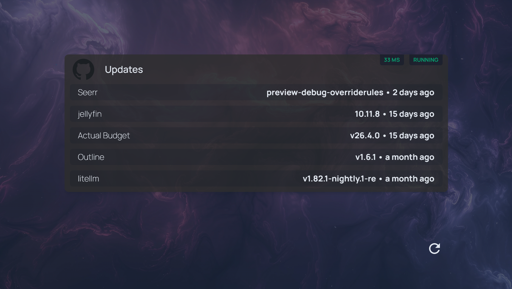

# rss-api

[](https://github.com/Skulldorom/rss-api/actions/workflows/ci.yml)
[](https://github.com/Skulldorom/rss-api/actions/workflows/docker.yml)

<p align="center">
  <a href="https://ko-fi.com/skulldorom"></a>
</p>

A small FastAPI proxy for the FreshRSS Google Reader API. It returns unread
items as a JSON list for [Homepage's Custom API widget](https://gethomepage.dev/widgets/services/customapi/).
Subscribe to feeds such as GitHub releases in FreshRSS, then use the widget
to see their unread items on your dashboard.



## Docker Compose quick start

1. [Enable API access in FreshRSS](https://freshrss.github.io/FreshRSS/en/users/06_Mobile_access.html)
   under **Authentication** and set an **API password** in the FreshRSS user's profile.
2. Clone the repository and copy the example environment file.

   ```sh
   git clone https://github.com/Skulldorom/rss-api.git
   cd rss-api
   cp .env.example .env
   ```

3. Edit `.env` using the settings below.
4. Start the API and check that it responds.

   ```sh
   docker compose up -d
   curl --fail http://localhost:5000/health
   ```

| Variable | Required | Value |
| --- | --- | --- |
| `FRESHRSS_HOST` | Yes | FreshRSS base URL as seen from the API container. Include any deployment subpath before `/api/greader.php` and omit the trailing slash. |
| `FRESHRSS_USER` | Yes | FreshRSS username. |
| `FRESHRSS_PASS` | Yes | API/GReader password from the FreshRSS profile, separate from the web login password. |
| `RSS_API_TOKEN` | No | Bearer token clients send to rss-api. Generate one with `openssl rand -hex 32` and replace the example value in `.env`. |

Compose and app startup both require nonempty FreshRSS settings. Keep the API
on a trusted network if `RSS_API_TOKEN` is blank or omitted, since anyone who
can reach the service can then fetch unread items. The supplied Compose file
publishes port 5000 on the host.

### Choosing the FreshRSS URL

| FreshRSS location | Example `FRESHRSS_HOST` |
| --- | --- |
| Service named `freshrss` on a network shared with `custom-api` | `http://freshrss` |
| Docker Desktop host with FreshRSS published on port 8020 | `http://host.docker.internal:8020` |
| Linux host with FreshRSS published on port 8020 | `http://192.168.1.10:8020` using the host's reachable IP |
| Reachable FreshRSS reverse proxy | `https://rss.example.com` |

Inside the API container, `localhost` points to rss-api itself. If FreshRSS
and rss-api run in separate Compose projects, attach both services to the
same Docker network to use the FreshRSS service name, or use a reachable
published address.

On Linux you can also set `FRESHRSS_HOST=http://host.docker.internal:8020`
with this addition to the existing `custom-api` service:

```yaml
services:
  custom-api:
    extra_hosts:
      - "host.docker.internal:host-gateway"
```

## API

| Endpoint | Behavior |
| --- | --- |
| `GET /health` | Returns `{"status":"ok"}` without authentication or an upstream request. |
| `GET /freshrss/unread` | Returns a JSON list with `title`, `feed`, `published` (Unix seconds), `url`, and `display` (title and relative age). Items without a publication time are skipped. |

For `/freshrss/unread`, `n` sets the upstream item limit (integer from 1 to
100, default 10). The optional `category` is a FreshRSS category label of up
to 200 characters. Omit it for the full unread reading list. Invalid query
parameters return HTTP 422.

```sh
curl --fail --get 'http://localhost:5000/freshrss/unread' \
  --header 'Authorization: Bearer YOUR_RSS_API_TOKEN' \
  --data-urlencode 'n=10' \
  --data-urlencode 'category=Tech News'
```

Replace `YOUR_RSS_API_TOKEN` with the configured token. Omit the header if
bearer auth is disabled. With auth enabled, missing or invalid credentials
return HTTP 401. Swagger UI is available at `/docs` and ReDoc at `/redoc`.

## Homepage

Add this group to Homepage's `services.yaml`. Use an address reachable from
the Homepage container and the same bearer token you set in rss-api. Remove
the `headers` block if bearer auth is disabled.

```yaml
- Feeds:
    - FreshRSS:
        href: https://rss.example.com
        siteMonitor: http://192.168.1.10:5000/health
        widget:
          type: customapi
          url: http://192.168.1.10:5000/freshrss/unread?n=10
          headers:
            Authorization: "Bearer YOUR_RSS_API_TOKEN"
          display: dynamic-list
          mappings:
            name: feed
            label: display
```

## Troubleshooting and updates

- **FreshRSS login returns 401.** Confirm that API access is enabled, verify
  the username, and use the API/GReader password from the user's FreshRSS profile.
- **`/health` succeeds but feeds fail.** The health check verifies that rss-api
  is running. Check whether the API container can reach `FRESHRSS_HOST` and
  inspect warnings with `docker compose logs custom-api`.
- **After editing `.env`.** Run `docker compose up -d` to apply the new settings.
- **To update to the published image.** Run `docker compose pull` and
  `docker compose up -d`. To build locally, replace the service's `image:`
  line with `build: .` and run `docker compose up -d --build`.

## Development and publishing

```sh
uv sync
uv run pytest
```

CI runs pytest and validates the Compose configuration on pull requests and
pushes to `main`. Tests stub FreshRSS, so development and CI need no live
FreshRSS instance.

The Docker workflow accepts only successful CI runs from pushes to this
repository's `main`. It checks out the tested commit and publishes
`ghcr.io/skulldorom/rss-api:<commit-sha>`. A rerun reuses an existing commit
image. Publishing jobs run one at a time, and a job only updates `latest`
if its tested commit is still at the tip of `main` at promotion time.

If a branch rule requires the old workflow, verify the required check against
the first pull request that shows the new **CI** workflow. The job name
remains `test`. Update any rule that refers to the old workflow path or
display name to use `.github/workflows/ci.yml` or **CI / test**, as applicable.
